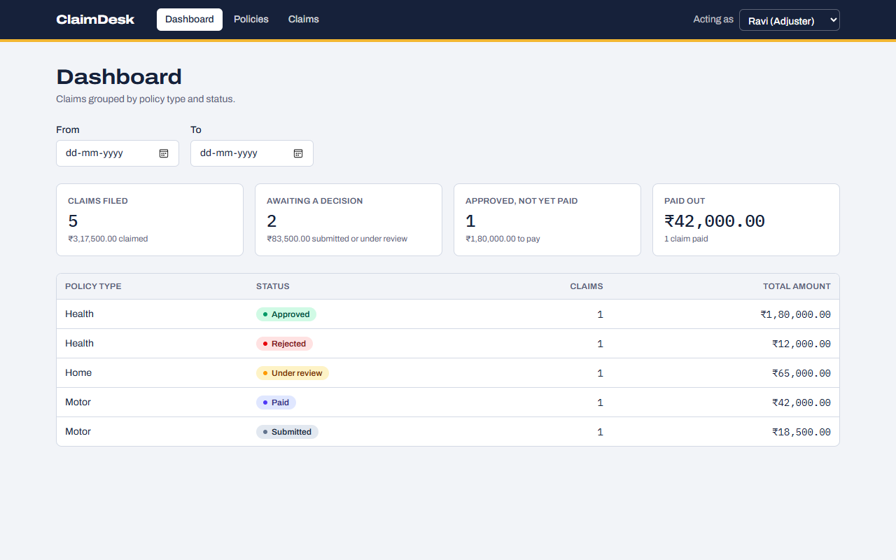
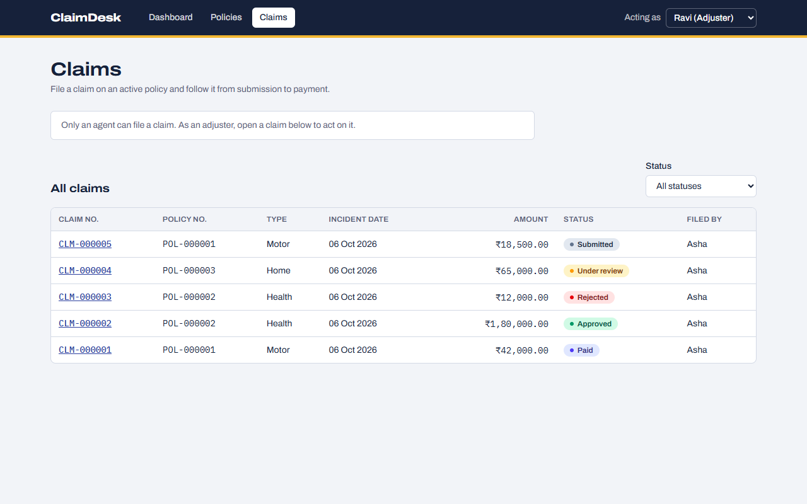
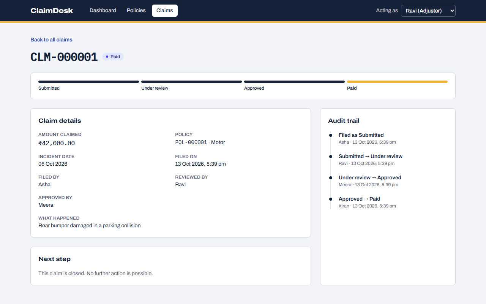

# ClaimDesk

ClaimDesk is a small insurance policy and claims tracker. An agent issues a policy and files a claim on it,
an adjuster reviews the claim, a second person approves or rejects it, and a manager records the payment.
Every status change is kept in an audit trail.

I built it to practise the stack that insurance back-office systems are usually written in:
ASP.NET Core, Entity Framework Core and SQL Server behind a React front end.







## What it does

- **Policies.** Get a quote (premium = sum insured x yearly rate: Motor 2.5%, Health 4.0%, Home 0.8%), issue the
  policy for a one-year term, cancel it. Each policy shows the cover it has left.
- **Claims.** File a claim on an active policy. The incident date must be inside the term and the amount must
  fit in the remaining cover.
- **Workflow.** `Submitted -> UnderReview -> Approved or Rejected`, then `Approved -> Paid`.
- **Maker-checker.** The person who reviewed a claim cannot approve it. A claim above 1,00,000 can be approved
  only by a manager.
- **Audit trail.** Who changed the status, from what, to what, and when.
- **Dashboard.** Claim count and total amount per policy type and status, with a date filter.

There are three roles (Agent, Adjuster, Manager) and four seeded users. The header has an "Acting as" switcher,
so the whole flow can be tried from one browser tab.

## Stack

| part | what I used |
|------|-------------|
| API | ASP.NET Core 10 Web API (controllers), C# |
| Data access | Entity Framework Core 10, code-first migrations |
| Database | SQL Server 2022: a trigger, a stored procedure, a covering index, `rowversion` |
| Front end | React 19, TypeScript, React Router, Tailwind CSS, Vite |
| Tests | xUnit, `WebApplicationFactory` against a real SQL Server, Vitest, React Testing Library, Playwright |
| Delivery | Multi-stage Dockerfile, Docker Compose, GitHub Actions |

## Run it

### With Docker

```bash
docker compose up --build
```

Open <http://localhost:8080>. Compose starts SQL Server and one app container. The app container holds the API
and the built front end, creates the database on its first start and seeds four users and three customers.

The `sa` password is read from `SA_PASSWORD`. If it is not set, a development default is used. To choose your own,
put `SA_PASSWORD=...` in a `.env` file next to `docker-compose.yml` (the file is ignored by git).

### For development (two terminals)

You need the .NET 10 SDK, Node 22 and a SQL Server. The simplest SQL Server is a container:

```bash
docker run -d --name claimdesk-sql -e ACCEPT_EULA=Y -e "MSSQL_SA_PASSWORD=ClaimDesk_Dev#2026" \
  -p 14333:1433 mcr.microsoft.com/mssql/server:2022-latest
```

Terminal 1, the API on <http://localhost:5080>:

```bash
cd api/ClaimDesk.Api
dotnet run
```

Terminal 2, the front end on <http://localhost:5173>:

```bash
cd web
npm install
npm run dev
```

The Vite dev server forwards `/api` to the API, so the browser only ever talks to one address.
To use another SQL Server, set the `ConnectionStrings__ClaimDesk` environment variable before `dotnet run`.

### A two-minute tour

1. As **Asha (Agent)**, open Policies, get a quote and issue a policy. Then open Claims and file a claim on it.
2. Open the claim. Switch to **Ravi (Adjuster)** and press "Start review". Ravi is not offered "Approve",
   because he reviewed the claim.
3. Switch to **Meera (Adjuster)** and approve it.
4. Switch to **Kiran (Manager)** and mark it as paid. The audit trail now has four entries, one per person.

## Design decisions

### A layered API with DTOs

```
Controllers  ->  Services  ->  Domain (entities and rules)
                    |
                  Data (DbContext, migrations)
```

- **Controllers** only deal with HTTP. Every action is a one-line call into a service.
- **Services** hold the use cases: load, check the rules, save, return a DTO.
- **Domain** holds the entities and the rule classes.
- **DTOs** are the JSON shapes. The entities never leave the API and are never filled from a request body.
  This means a client cannot set a field it should not (for example `status` or `premium`), and I can change
  a table without changing the contract in [docs/API.md](docs/API.md).

Errors are handled in one place. Services throw small exceptions (`NotFoundException`, `ForbiddenException`,
`BusinessRuleException`) and `GlobalExceptionHandler` turns them into RFC 7807 problem details with the right
status code.

### Rule classes

The business rules live in three small static classes with no database access:
`PremiumCalculator`, `ClaimWorkflow` (allowed transitions, who may make them, the filing and approval checks)
and `RoleGuard`. Because they take plain values and return or throw, they are tested by 51 unit tests that run
in milliseconds without a database.

### Maker-checker

Approving a claim checks two things in `ClaimWorkflow.EnsureCanApprove`:

- the approver is not the user who reviewed the claim (otherwise `409`, a business rule was broken);
- a claim above 1,00,000 is approved by a Manager (otherwise `403`, the role may not do this).

The front end hides the Approve button in both cases, but that is only for convenience. The API is the one that
enforces the rules. The integration tests check both cases over HTTP, and the end-to-end test checks the reviewer
case twice: the button is not shown, and the API still answers `409`.

### Audit trail by a trigger

The `ClaimAudits` rows are written by the SQL Server trigger `trg_Claims_StatusAudit` (`AFTER INSERT, UPDATE` on
`Claims`), not by C# code. The application has no code that inserts an audit row.

Why a trigger: the audit trail must not depend on every code path remembering to write it. A status changed by
the API, by a script or by hand in SQL is recorded the same way.

Two details worth knowing:

- The trigger is set-based. It joins the `inserted` and `deleted` tables, so an `UPDATE` that touches ten
  claims writes ten audit rows, and an update that leaves the status alone writes none.
- A trigger cannot know which application user made the change. So `Claims` has a `LastChangedByUserId` column
  that the API sets with every status change, and the trigger copies it into the audit row.

### Summary by a stored procedure

The dashboard numbers come from `usp_ClaimsSummary(@From, @To)`: a `GROUP BY` over policy type and claim status,
filtered on the incident date (both days included). `ReportService` calls it through EF Core's `SqlQuery`, which
sends the two dates as SQL parameters.

Why a stored procedure: a report is one set-based query, and SQL is the right tool for it. The trigger, the
procedure and the index are in a hand-written migration (`AuditTriggerAndReport`), so `dotnet ef database update`
still builds the whole database.

### Optimistic concurrency with rowversion

`Claims` has a `rowversion` column. SQL Server changes it on every update. The API returns it as base64, and
approve, reject and pay must send back the value the client last read. EF Core adds
`WHERE RowVersion = @original` to the `UPDATE`; if no row matches, somebody else changed the claim first and the
API answers `409`. The claim page then shows the message and reloads the claim.

Why not locks: a person can keep a claim open for minutes. Optimistic concurrency holds no lock during that time
and still makes sure nobody overwrites a decision without seeing it.

### Demo identity by a header (not real authentication)

There is no login. Every request carries `X-User-Id`, and `CurrentUserFilter` loads that user and its role.
A missing or unknown id gets `401`; a role that may not do the action gets `403`.

I chose this so that anyone trying the project can switch between the four users in one click and see the role
rules and maker-checker work. **It is not authentication.** Anyone can send any id, and there are no passwords
or tokens. A real system would use JWT bearer tokens from an identity provider (or ASP.NET Core Identity) and
read the user and role from the token's claims. The role checks themselves would stay as they are; only the place
the current user comes from would change.

### Smaller choices

- Policy and claim numbers (`POL-000001`, `CLM-000001`) are computed columns, so they cannot drift from the id.
- Remaining cover is not stored. It is calculated in SQL as the sum insured minus the Approved and Paid claims.
- In Docker one container serves both the API and the built React app (`UseStaticFiles` plus a fallback to
  `index.html` for front-end routes), so there is no CORS to configure.

## API

The full contract, with shapes and validation rules, is in [docs/API.md](docs/API.md).

| method | path | who | returns |
|--------|------|-----|---------|
| GET | `/api/users` | anyone (no header) | `User[]` |
| GET | `/api/customers` | any user | `Customer[]` |
| POST | `/api/customers` | Agent, Manager | `201 Customer` |
| POST | `/api/policies/quote` | any user | `Quote` (nothing is saved) |
| POST | `/api/policies` | Agent, Manager | `201 Policy` |
| GET | `/api/policies?status=&customerId=` | any user | `Policy[]` |
| GET | `/api/policies/{id}` | any user | `Policy` |
| POST | `/api/policies/{id}/cancel` | Agent, Manager | `Policy` |
| POST | `/api/claims` | Agent | `201 Claim` |
| GET | `/api/claims?status=&policyId=` | any user | `Claim[]` |
| GET | `/api/claims/{id}` | any user | `ClaimDetail` (claim plus audit trail) |
| POST | `/api/claims/{id}/review` | Adjuster | `Claim` |
| POST | `/api/claims/{id}/approve` | Adjuster, Manager | `Claim` |
| POST | `/api/claims/{id}/reject` | Adjuster, Manager | `Claim` |
| POST | `/api/claims/{id}/pay` | Manager | `Claim` |
| GET | `/api/reports/claims-summary?from=&to=` | any user | `ClaimsSummaryRow[]` |

Errors are problem details: `400` validation (with an `errors` map per field), `401` unknown user, `403` role not
allowed, `404` not found, `409` business rule broken or stale `rowVersion`.

`api/ClaimDesk.Api/ClaimDesk.Api.http` has a sample request for every step, and in development the OpenAPI
document is at `/openapi/v1.json`.

## Tests

| suite | count | what it covers | how to run |
|-------|-------|----------------|------------|
| Unit (xUnit) | 51 | `PremiumCalculator` (8) and `ClaimWorkflow` (43): rates, rounding, every transition, role checks, maker-checker, cover checks. No database. | `dotnet test ClaimDesk.slnx` |
| Integration (xUnit) | 40 | The real API over HTTP against a real SQL Server: policies (20), claims (17), report (3). Includes the trigger, the stored procedure, a stale `rowVersion`, `401`/`403`/`404`/`409` and validation errors. | `dotnet test ClaimDesk.slnx` |
| Front end (Vitest) | 31 | The API client, role rules, formatting, the policy and claim forms and the claim page, with `fetch` replaced by a fake. | `cd web && npm run test` |
| End to end (Playwright) | 1 | The whole flow in a real browser against the running stack: Asha issues a policy and files a claim, Ravi reviews and cannot approve, Meera approves, Kiran pays, and the audit trail shows the four changes in order. | `cd web && npm run e2e` |

Notes:

- Each integration test class gets its own database named `ClaimDesk_Test_<guid>`, created when the tests start
  and dropped when they end. The server is `localhost,14333` unless `ConnectionStrings__ClaimDesk` is set.
- The end-to-end test needs the API running on port 5080 and Microsoft Edge installed. It starts the Vite dev
  server by itself. Every run adds one policy and one claim to the development database.
- `npm run screenshots` retakes the three pictures above. If the database has fewer than five claims, it first
  adds three policies and five claims through the API.
- GitHub Actions (`.github/workflows/ci.yml`) runs two jobs on every push and pull request: `api` builds the
  solution and runs the xUnit tests against a SQL Server service container, and `web` runs lint, the Vitest tests
  and the production build.

## Project layout

```
api/
  ClaimDesk.Api/
    Controllers/      HTTP endpoints, one line each
    Services/         use cases and EF Core queries
    Domain/           entities, enums, exceptions, PremiumCalculator, ClaimWorkflow, RoleGuard
    Dtos/             request and response shapes
    Data/             DbContext, seeding, migrations (schema, then trigger + procedure + index)
    Infrastructure/   CurrentUserFilter, GlobalExceptionHandler
  ClaimDesk.Tests/    Unit/ and Integration/
web/
  src/api/            typed fetch client and the contract types
  src/auth/           the "acting as" user and what each role may do
  src/components/     buttons, fields, table, status badge, layout
  src/pages/          dashboard, policies, claims, claim detail
  e2e/                Playwright test and the screenshot script
docs/                 API.md (the contract) and screenshots
Dockerfile, docker-compose.yml, .github/workflows/ci.yml
```

## Limits and next steps

What is missing, in the order I would fix it:

- **No real authentication.** The `X-User-Id` header is a demo device (see above). Next step: JWT bearer tokens
  and role claims.
- **The cover check is not atomic across claims.** `rowversion` protects one claim. Two different claims on the
  same policy approved at the same instant could both pass the remaining-cover check. Next step: do the check
  and the update in one serializable transaction, or lock the policy row.
- **Policies expire lazily.** An ended policy is marked `Expired` the next time policies are read. There is no
  scheduled job.
- **No paging or search.** The list endpoints return every row, which is fine for a demo and wrong for real data.
- **Small scope.** No editing or deleting of customers, no renewals, no documents on a claim, and "Paid" is only
  a status, not a payment.
- **Migrations run when the app starts.** That keeps the demo to one command. A real deployment would run them
  as a separate step, and would not connect as `sa`.
- **Dates.** "Today" on the server is the UTC date, and a claim may carry an incident date that is still in the
  future but inside the term.
- **Test gaps.** The dashboard, the two list pages, the add-customer form and the cancel button have no component
  tests of their own. The end-to-end test runs on my machine only; it is not part of CI yet.
- **Tool versions.** Vite 6, oxlint 1.16 and jsdom 26 are pinned because my machine has Node 22.11 and their newer
  major versions need 22.12 or later.

## Licence

[MIT](LICENSE)
